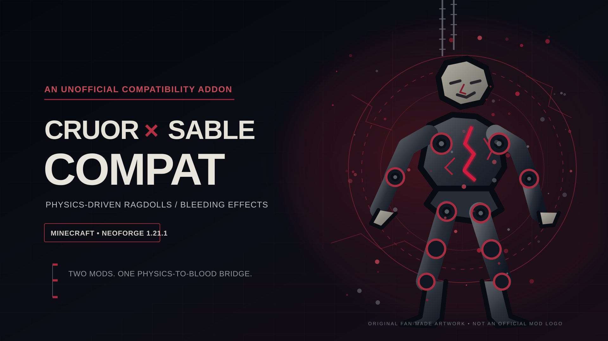

# Cruor × Sable Compat



[](https://github.com/MAKAKAIglitch/Cruor-Sable-Compat/actions/workflows/build.yml)
[](https://www.minecraft.net/)
[](https://neoforged.net/)
[](https://adoptium.net/)
[](LICENSE)

Unofficial NeoForge compatibility addon for **Cruor** and **Sable: Ragdolls**.

The project is intended to connect Cruor's bleeding and wound effects to Sable's physics-driven player and mob ragdolls. Both upstream mods remain separate dependencies and are never bundled into this repository's mod JAR.

## Status

**0.1.0-alpha — prototype**

The current prototype:

- Hooks the server physics tick for Sable player and mob ragdoll parts.
- Resolves original player and mob UUIDs using the Sable 0.7.2 methods.
- Reads the current world position from each part's Sable `logicalPose`.
- Starts a short bleeding window only after real health damage.
- Emits a small dark-red particle at the moving physical part as a temporary visual fallback.
- Retains a part's source UUID briefly after limb separation.

**This is not yet the native Cruor integration.** The current emitter uses Minecraft's dust particle and does not call Cruor's wound, droplet, stain, or pool implementation. The native bridge still needs exact Cruor API/bytecode verification and in-game testing before this can be called a complete compatibility release.

## Supported setup

| Component | Development target |
|---|---|
| Minecraft | 1.21.1 |
| Loader | NeoForge 21.1.228 or newer 21.1.x |
| Java bytecode | Java 21 |
| Sable: Ragdolls | 0.7.2 |
| Cruor | 0.1.5-beta for 1.21.1 NeoForge |

Official upstream projects:

- [Cruor — Raiiiden](https://www.curseforge.com/minecraft/mc-mods/cruor)
- [Cruor 0.1.5-beta file](https://www.curseforge.com/minecraft/mc-mods/cruor/files/9484422)
- [Sable: Ragdolls — leonardoinc22](https://www.curseforge.com/minecraft/mc-mods/sable-ragdolls)

## Build

### Windows

Double-click `build.bat`, or run it from PowerShell:

```powershell
.\build.bat
```

You can pass Gradle tasks through the builder:

```powershell
.\build.bat clean build
.\build.bat runClient
```

### Linux

```sh
chmod +x ./build.sh
./build.sh
```

Examples:

```sh
./build.sh clean build
./build.sh runClient
```

### What the automated builder does

The project-local builder follows the approach used by [Fiximizer](https://github.com/MAKAKAIglitch/Fiximizer):

- Detects an installed JDK 21, including common Prism Launcher locations.
- If no JDK 21 is available, downloads Eclipse Temurin 21 into `.tools/`.
- Verifies the downloaded JDK archive against Adoptium's published SHA-256 checksum before extraction.
- Uses the pinned Gradle Wrapper; it does not require a system-wide Gradle installation.
- Does not replace system Java, change system environment variables, or install a system package.
- Reuses Gradle's local dependency and build caches.

See [BUILDING.md](BUILDING.md) for details.

The distributable mod JAR is written to `build/libs/`. Sable and Cruor are development runtime dependencies only; they are not shaded or copied into the compatibility JAR.

## Performance notes

The prototype keeps work on the server physics side and uses several small safeguards:

- Reflection lookups are cached per runtime class with `ClassValue`, rather than rediscovered on every physics tick.
- Particle emission is rate-limited per physical part.
- Source UUID and particle bookkeeping use compact UUID/position keys rather than allocating string keys every tick.
- Expired cache entries are pruned periodically.
- No per-part scheduled tasks, client entity scans, or extra physics engine are created.

These are code-path reductions, not a claim of a measured FPS or TPS improvement. Runtime profiling and gameplay tests are still required.

The build workflow checks NeoForge 21.1.228 (the Sable 0.7.2 build baseline) and 21.1.265 on both Linux and Windows.

## Licensing and attribution

Original compatibility source code is MIT-licensed. The MIT license does not relicense the upstream mods.

- Sable Ragdolls is authored by leonardoinc22; its published source repository states that its code is all rights reserved and must not be redistributed. This repository does not copy or package its source.
- Cruor is authored by Raiiiden. This repository does not copy or package Cruor source, assets, or JARs.
- Both upstream mods remain the property of their respective authors.

See [THIRD_PARTY_NOTICES.md](THIRD_PARTY_NOTICES.md) for the detailed attribution and dependency notes.

This is an unofficial community compatibility project. It is not affiliated with, endorsed by, or an official addon of Cruor, Sable, Mojang, Microsoft, or NeoForge.
